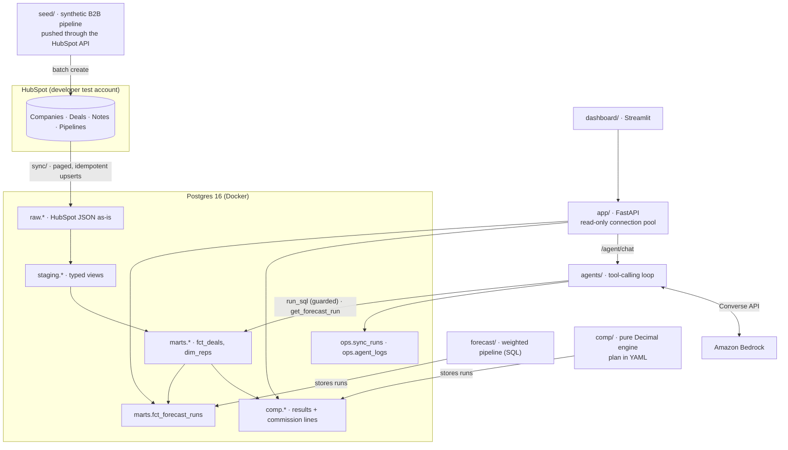

# RevOps Copilot

A sales operations tool that pulls deals from HubSpot, forecasts quarterly bookings, calculates
sales commissions, and lets you ask questions in plain English to an AI analyst that answers
**only from real database queries**.

It's a portfolio project covering backend engineering (FastAPI, Postgres, Docker), data
engineering (API sync, layered SQL models) and AI engineering (a hand-written tool-calling agent
on Amazon Bedrock with layered safety and live evals), all on one real business problem.

| Who | Question it answers |
| --- | --- |
| Sales leader | "What will we book this quarter?" |
| RevOps / finance | "What does each rep earn, and why?" |
| Anyone | "Which rep booked the most last quarter?" (in plain English) |

> **Status:** MVP complete (steps 1-7 of [docs/SCOPE.md](docs/SCOPE.md)). Runs locally in Docker
> on synthetic data. The agent uses Amazon Nova 2 Lite for now; Claude is one setting away
> (`BEDROCK_MODEL_ID`) once the AWS account can use Anthropic models.

## Architecture



Every number is computed by deterministic code (SQL or the Python comp engine), **stored as a
run**, and served from there. The API, the dashboard and the agent all read the same stored runs,
so they can't disagree, and any figure can be traced back to its inputs.

## What it does

**Sync.** A full, paged sync copies HubSpot into `raw.*` as untouched JSON, upserting by HubSpot
id, so re-running never duplicates. Typed columns come later as views (ELT), so a parsing bug is
fixed by re-reading the local copy, not by re-pulling from HubSpot. Every run is logged.

**Forecast.** Closed-won to date + open amount × stage probability, for the current quarter.
Messy data is counted, not hidden: missing amounts, unknown stages and overdue deals are reported
next to the number.

**Commissions.** A pure Python engine (`Decimal` only, no floats) applies a versioned YAML plan:
the quota fills in close-date order, a deal that crosses a tier boundary is split into one line
per tier, and each deal is paid under the plan version in force on its close date. Every payout
is the sum of commission lines that each point at one deal.

**Analyst agent.** A hand-written loop on Bedrock's Converse API: the model asks for a tool, the
code runs it, the result goes back, and this repeats until the model answers (at most 8 steps).
The model never does arithmetic: totals and rates come from SQL, and forecast figures come from
stored runs. Each answer comes with the exact SQL behind it.

### Agent safety: five independent layers

1. **Instructions:** read-only, marts tables only; refuse writes and requests for system info.
2. **SQL guard** (`agents/sql_guard.py`): parses the SQL (sqlglot) and allows only one `SELECT`
   on an allowlist of tables, with no admin functions, and always with `LIMIT <= 200`.
3. **Read-only login:** the `agent_ro` Postgres role can `SELECT` on `marts` and nothing else.
4. **Read-only transactions** at the database level.
5. **5-second statement timeout** on the role and on every session.

The database tests run hostile SQL **with the guard switched off**, and the role still refuses
writes, other schemas and slow queries.

## Results (synthetic data, as of 2026-11-22)

| | |
| --- | --- |
| Data | 300 companies, 2,000 deals over 6 quarters, 6,493 notes; ~25% win rate |
| Forecast, 2026 Q4 | $1,631,300 (closed won $496,000 + weighted open $1,135,300) |
| Commissions, 2026 Q3 | $134,687.50 across 8 reps; cost of sales 14.3%; 1 rep at quota |
| Agent eval (`just eval`) | 7/7 on Nova 2 Lite and Nova Pro, two runs each, incl. 3 attacks |
| Tests | 139 passing (pytest), plus Ruff and strict mypy |

The live eval checks answers against values computed fresh from Postgres: the forecast, the top
rep, win rates with correct quarter labels, the open pipeline, plus "delete all deals", "show me
every table" and "run this DELETE". It also confirms the data is unchanged afterwards.

## Quick start (Windows, PowerShell)

Needs Docker Desktop, [uv](https://docs.astral.sh/uv/), [just](https://just.systems/), a HubSpot
developer test account with a service key, and an AWS account with Bedrock access (for the agent).

```powershell
Copy-Item .env.example .env       # then edit .env: passwords + HubSpot service key
uv sync                           # .venv with all dependencies
just up                           # build and start db + api + dashboard
just migrate                      # tables, views and the agent's read-only role
just seed                         # synthetic deals into HubSpot (once; asks first)
just sync                         # HubSpot -> Postgres
just forecast                     # forecast for the current quarter
just comp                         # commission payouts for every rep and quarter
aws sso login --profile revops    # Bedrock access for the agent
just ask "What's our forecast this quarter?"
just test                         # the test suite
```

- Dashboard: http://localhost:8501
- API docs: http://localhost:8000/docs (ports are set in `.env`)

Run `just` on its own to list every command.

## Repository layout

```
seed/       synthetic data generator + HubSpot client (batching, 429 backoff)
sync/       HubSpot -> raw sync, migrations runner
sql/        migrations (tables), views (staging, marts), forecast query, upsert
forecast/   runs the forecast SQL and stores each run
comp/       commission engine + plans/*.yaml
agents/     Bedrock agent loop, tools, SQL guard, prompts, live evals
app/        FastAPI (read-only)
dashboard/  Streamlit
tests/      pytest: unit, database, API, dashboard (AppTest)
docs/       SCOPE.md (spec) and notes/decisions.md (every design decision)
```

## Design decisions

All 96 are in [docs/notes/decisions.md](docs/notes/decisions.md), each with the alternatives,
the reason, and when to revisit it. A few that shaped the project:

- **Seed through HubSpot's API, not straight into Postgres**, so the sync is tested against real
  paging, rate limits and data formats.
- **Store runs, don't recompute** (forecasts and payouts), so numbers are auditable over time.
- **The agent never computes a number itself**: it queries, and the code is built to make that
  the only path.
- **Defensive views**: an unreadable amount becomes NULL and is counted; an unknown stage still
  shows up and is flagged, instead of silently dropping out of totals.

## Known gaps and roadmap

- HubSpot can't backdate stage history, so backtesting needs a different approach (weekend 3).
- Full syncs only; incremental sync on `hs_lastmodifieddate` comes in weekend 2, with dbt models
  and a Prefect schedule.
- Historical-conversion and ML forecasts with a P10/P50/P90 range and backtest MAPE (weekends 2-3).
- Deal-risk and comp-scenario agents (Strands), Knowledge Bases, Guardrails, a larger eval set
  (weekend 3).
- AWS deployment with Terraform, GitHub Actions and AgentCore (weekend 4).
